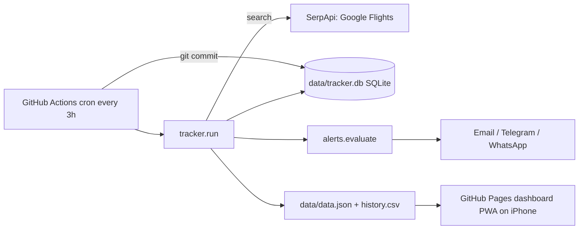

# Fare Tracker: DEL → CCU, 13 Dec 2026

A zero-cost fare tracker that runs on GitHub Actions (not on your iPhone), stores history in the repo, emails you on price changes, and shows a mobile dashboard you can add to your Home Screen.

## Read this first: honest limits

1. **Check frequency is every 3 hours, not 30–60 minutes.** The only free source I could verify (SerpApi's Google Flights API) allows **250 searches/month**. 8 checks/day ≈ 240/month. Hourly checks would burn the quota in ~10 days. Faster checking needs a paid source or an unauthorised scraper; this project does neither.
2. **Google has no public Flights API.** SerpApi is a third-party commercial service that returns Google Flights results. It is not an "official" Google integration, and Google sued SerpApi in Dec 2025 (reported). If SerpApi stops working, add another provider (see below).
3. **GitHub scheduled runs are best-effort.** They can be delayed by 5–60 minutes at busy times, and GitHub disables scheduled workflows in public repos after 60 days with no repo activity. The bot commits data after each run, which should count as activity, but verify this after a couple of months. If disabled, tap *Enable workflow* in the Actions tab.
4. **WhatsApp is not free.** Email and Telegram are the free channels. WhatsApp code is included but off by default.
5. **I could not test against live services** (no SerpApi key, no SMTP, no GitHub access from here). Everything was tested with a faked HTTP layer (19 automated tests pass, plus a dry-run end-to-end). Your first real run is the real test.

## Architecture



**Persistence:** Actions runners are wiped after every run, so the workflow commits `data/tracker.db`, `data/data.json`, and `data/history.csv` back to the repo. The dashboard reads `data.json` from `raw.githubusercontent.com` (cached up to ~5 minutes).

## Cost table (verified this session unless marked)

| Component | Selected service | Free limit / condition | Expected cost |
|---|---|---|---|
| Scheduled execution | GitHub Actions, **public repo** | Free for standard runners in public repos; 5-min minimum cron; delays; 60-day inactivity disable. | ₹0 |
| Flight price data | SerpApi Google Flights | **Free plan: 250 searches/month, recurring, no card** (not a trial). Failed searches aren't counted. | ₹0 |
| Historical storage | SQLite committed to the repo | Repo size limits are far above what this uses. | ₹0 |
| Dashboard hosting | GitHub Pages (public repo) | *Not re-verified here:* Pages is free for public repos. | ₹0 |
| Email | Gmail SMTP + App Password | *Not re-verified here:* needs 2-Step Verification on the Google account. | ₹0 |
| Telegram (optional) | Telegram Bot API | *Not re-verified here.* | ₹0 |
| WhatsApp (optional) | Meta WhatsApp Cloud API | Proactive alerts need approved templates, billed per message (about ₹0.145 for utility, per a third-party report; check Meta's rate card). Free replies only inside a 24-hour window after *you* message the bot. Needs a Meta business account. | **Not ₹0** |

**Source options I checked and rejected:** Amadeus Self-Service shut down on 17 July 2026. Ignav offers only 1,000 free requests (one-time, then $2 per 1,000), so it is a trial; I did not implement it because I could not verify its response format. `fast-flights`-style Google scraping is excluded because it conflicts with your no-ToS-violation rule.

**Public repo consequence:** your price history and config are public. Passwords/keys are never in the repo (GitHub Secrets only). Don't put anything private in `config.yaml`.

## Project layout

```
config.yaml                  route, date, target price, thresholds, channels
.env.example                 secret names (local use only)
.github/workflows/track.yml  scheduler + commit-back
tracker/  config.py models.py store.py alerts.py notify.py report.py run.py
tracker/providers/  base.py serpapi.py __init__.py   (add new sources here)
tests/  test_alerts.py test_run.py
data/   tracker.db data.json history.csv (created by runs)
docs/   index.html sw.js manifest.webmanifest icons (dashboard / PWA)
```

## Set up from your iPhone (Safari)

**Step 0, getting the files into GitHub is the awkward part on a phone.** In the Files app, unzip the project. In github.com, create a new **public** repository, then for each folder use *Add file → Create new file*, type a path like `tracker/providers/.gitkeep` (a `/` creates a folder), commit, then *Add file → Upload files* inside that folder to add the files. Dot-folders (`.github/workflows/track.yml`) need *Create new file* with that exact path and pasted contents. If you have any computer, `git push` is much faster.

1. **SerpApi key:** sign up at serpapi.com (free plan, no card), copy the API key from your dashboard.
2. **Gmail App Password:** Google Account → Security → turn on 2-Step Verification → App passwords → create one → copy the 16 characters.
3. **GitHub Secrets:** repo → Settings → Secrets and variables → Actions → *New repository secret*. Add `SERPAPI_KEY`, `SMTP_USER` (your Gmail address), `SMTP_PASSWORD` (the app password), `EMAIL_TO` (where alerts go).
4. **Enable the workflow:** Actions tab → enable workflows → *track-fares* → *Run workflow*.
5. **Confirm it works:** within a minute you should get an email *"✈ Flight tracker is on"* with the first fare. Check the run's green tick in Actions and a new commit "data: update fares".
6. **Dashboard:** Settings → Pages → Source: *Deploy from a branch*, branch `main`, folder `/docs`. Open `https://YOUR_USER.github.io/YOUR_REPO/` in Safari → Share → **Add to Home Screen**.
7. *(Optional)* Telegram: create a bot with @BotFather, message it once, get your chat id, add `TELEGRAM_BOT_TOKEN` and `TELEGRAM_CHAT_ID` secrets, set `channels.telegram: true`.

## Change route, date, target price

Open `config.yaml` on GitHub → pencil icon → edit → Commit. Change `route.origin`, `route.destination`, `route.date`, `route.passengers`, `filters.airlines`, `alerts.target_price`, `alerts.min_change_abs/min_change_pct`. A new route/date starts a fresh history automatically (history is keyed per route). The dashboard's Settings tab links straight to the editor. To change frequency, edit the `cron` line in `track.yml` **and** `schedule.expected_interval_hours`; stay under 250 searches/month.

## Alert rules

Decrease, increase, recovery (rise after a record low), target reached, new lowest fare. Changes count as significant at ≥ `min_change_abs` **or** ≥ `min_change_pct`. If the same flight (flight number + departure time) is in both searches it is compared directly; otherwise the alert says it is a **route-level change**. Duplicate prevention: changes are measured against the previous successful check (unchanged price = no alert); target alerts re-fire only after the price goes above target and comes back, or drops further. Failed or empty searches are logged but never stored as prices. One failure email is sent after 3 consecutive failures, then none until recovery.

## Add another price source

Create `tracker/providers/yours.py` with a class having `name`, `label`, and `search(cfg) -> list[Flight]` that raises `ProviderError`/`NoResults` on failure; register it in `providers/__init__.py`; set `provider:` in `config.yaml`.

## Troubleshooting

| Symptom | Likely cause / fix |
|---|---|
| No "tracker is on" email | Check the Actions run log. "SMTP… not set" = secret missing/misspelled. Gmail login failure = use the App Password, not your normal password. Check spam. |
| Dashboard says "No data yet" | Run the workflow once. If the page isn't on `github.io`, open it once with `?repo=USER/REPO`. |
| Status shows "Source error" | Log message names it: bad/missing key, quota used (HTTP 429), or SerpApi outage. |
| "Skipped: monthly cap" | Your cap (240) was reached; it resets next calendar month (UTC). SerpApi's own cycle may differ slightly. |
| Runs stopped | Workflow auto-disabled after 60 days idle: Actions → *track-fares* → Enable. |
| Push rejected in last step | Re-run; the workflow rebases before pushing and runs are serialised. |
| Prices differ from airline sites | Google Flights shows OTA/airline fares with its own rounding and fees; always confirm on the booking page. |

## Security & privacy checklist

- [x] No credentials in code; all via GitHub Secrets / env vars.
- [x] SerpApi network errors never print the request URL (it contains the key).
- [x] Notification errors log type + short message only.
- [x] Dashboard is static, with no keys, and reads only public JSON.
- [ ] **You:** keep `.env` out of git (`.gitignore` covers it), use a Gmail App Password (revocable), and remember the repo is public.

## Final checklist

| Feature | Implemented | Tested here | Free | Depends on external approval/account |
|---|---|---|---|---|
| Config-driven route/date/target | Yes | Yes (unit) | Yes | |
| SerpApi provider + parser | Yes | Parser only (fixture shaped like SerpApi docs); **live call untested** | Yes (250/mo) | SerpApi account |
| SQLite history + CSV/JSON export | Yes | Yes | Yes | |
| Alert rules + dedupe | Yes | Yes (19 tests) | Yes | |
| Failure handling, quota guard, resume | Yes | Yes | Yes | |
| Email (start, alerts, daily summary, failure) | Yes | Content verified in dry-run; **real SMTP untested** | Yes | Gmail App Password |
| Telegram | Yes | **Untested** | Yes | Bot token |
| WhatsApp (Cloud API template) | Yes | **Untested** | **No** | Meta business account + approved template |
| GitHub Actions scheduler | Yes | **Not run on GitHub** | Yes (public repo) | |
| Dashboard + PWA | Yes | Rendered in headless browser with test data; **not tested on a real iPhone** | Yes | GitHub Pages enabled |
| Matplotlib charts | No: replaced by an in-page SVG chart (no extra dependencies) | | | |
| Dashboard config editing | Partly: read-only view + link to GitHub's editor (a static page can't safely write without exposing a token) | | | |
